<!--
  You opened the source. Good instinct: the interesting parts are usually underneath.

  The header trace is not decoration.
  Left half:  0101 0011 0100 0001  =  0x53 0x41  =  "SA", my initials in ASCII.
  Right half: an ECG rhythm strip. The highlight sweeps three beats every 2.5 s, which is 72 bpm.
  The heart's pacemaker is the sinoatrial node, which everyone abbreviates to SA.
  I did not plan to share initials with a cardiac structure. I am choosing to take it as a sign.
-->

<p align="center">
  <picture>
    <source media="(prefers-color-scheme: dark)" srcset="assets/signal-dark.svg">
    <source media="(prefers-color-scheme: light)" srcset="assets/signal-light.svg">
    
  </picture>
</p>

<p align="center">
  <sub>Both ends of that line are signed <b>SA</b>. On the left, my initials in ASCII. On the right, the heart's sinoatrial node.<br>Same signature, different hardware.</sub>
</p>

<p align="center">
  <a href="#01--current-fix">fix</a> ·
  <a href="#02--ships-log">log</a> ·
  <a href="#03--engineering-deck">deck</a> ·
  <a href="#04--built-in-public">built</a> ·
  <a href="#05--the-other-manual">frontier</a> ·
  <a href="#06--diagnostics">diagnostics</a> ·
  <a href="#07--signal">signal</a>
</p>

<br>

I'm Shahzad. I build software: backend systems in Go, mobile apps in Flutter and Swift, and lately the pipelines that let AI read financial documents without guessing. Five years of production have taught me that every system is a negotiation between what you designed and what actually happens.

I trained as a Computer Systems Engineer at UET Peshawar, which means I met computers from the transistor up. Somewhere along the way I noticed that the most sophisticated system I had ever encountered was the one running me, and it shipped with no documentation at all. So the long-term heading is medicine, ideally cardiothoracic surgery, with engineering and robotics coming along for the ride.[^1]

Until then I ship software, and keep a growing list of questions for the day I'm allowed into an anatomy lab.

<br>

## 01 · Current fix

```text
               ENGINEERING
                ·   N   ·                     CURRENT FIX
             ·      │      ·                  ────────────────────────────────────
          ·         │       * ·               position   software engineer, SDE III
        ·           │     /     ·             logged     5+ years in production
      ·             │   /         ·           hands on   Go · Flutter · Postgres
                    │ /                       heading    045° engineering × medicine
  AI  W ────────────┼──────────── E MEDICINE  bound for  medicine, then the heart
                    │                         eta        a decade, give or take
      ·             │             ·                      a residency
        ·           │           ·
          ·         │         ·               status     underway
             ·      │      ·
                ·   S   ·
                 ROBOTICS
```

<br>

## 02 · Ship's log

Navigators call it *dead reckoning*: you work out where you are from where you've been, how fast, and for how long. Here is mine.

```text
                    2021     2022     2023     2024     2025     2026
                    │        │        │        │        │        │
001  ML internship    ███
002  AntonX              ████████████████████████████████████████████████ ► now
003  Tripmate                                  █████████
004  Utor                                           █████████
005  CCript                                                        ██████ ► now
```

<sub>Overlapping bars are not a rendering bug. I have simply never been good at running one process at a time.</sub>

**`000` The Origin** · UET Peshawar · Class of 2021

B.Sc. Computer Systems Engineering, CGPA 3.60. Logic gates, microprocessors, signals, networks: computers taught bottom-up, which is the right way to meet anything you plan to spend your life debugging. The final-year project taught a phone to diagnose sick leaves. [More on that below.](#my-first-patients-were-leaves)

**`001` First Contact** · Machine Learning Internship · Apr – Aug 2021

Applied machine learning in the months around graduation. My first encounter with a model that is confidently wrong, and the start of a long, respectful relationship with validation sets.

**`002` Into Production** · AntonX · Aug 2021 – present

Walked in as an intern, now a Software Development Engineer III. Go services, PostgreSQL, AWS, Kubernetes, GitHub Actions, and an ELK stack for finding out what actually happened at 3 a.m. Products along the way include HalalNow and Tripmate. Five years in, production is still the most honest code reviewer I know.

**`003` Tripmate** · Jan 2024 – Jan 2025

A travel product built around maps: Flutter, Mapbox and Firebase, shipped to iOS and Android. It taught me that a map is a UI, a database and a networking problem, all pretending to be a picture.

**`004` Building for the Pocket** · Utor · Mobile Engineer · Jul 2024 – Aug 2025

Mobile products across several startups: Frich (Series A, ~$2M raised), Arête, Auura AI and BhogAI. Different domains, one recurring lesson: a phone is a small distributed system that its user can drop in a puddle.

**`005` Money, Documents & Machines That Read** · CCript · 2026 – present

Fintech and mortgage technology for Nexa Lending and bevri.ai: borrower onboarding, POS and LOS integrations, intelligent document processing and AI-assisted workflows, running on Google Cloud with Go, PostgreSQL, Cloud Run, GitHub Actions, Stripe and OAuth. The documents arrive as pay stubs, bank statements, tax forms, and the occasional photo taken at an angle that suggests a moving vehicle. The software has to read all of them correctly, because someone's home depends on it.

**`006` The Next Frontier** · Medicine · [see below](#05--the-other-manual)

<br>

## 03 · Engineering deck

<table>
  <tr>
    <td><b>Languages</b></td>
    <td></td>
    <td>SQL</td>
  </tr>
  <tr>
    <td><b>Backend &amp; data</b></td>
    <td></td>
    <td>REST · gRPC · concurrency · distributed systems · system design</td>
  </tr>
  <tr>
    <td><b>Mobile &amp; web</b></td>
    <td></td>
    <td>iOS · SwiftUI</td>
  </tr>
  <tr>
    <td><b>Cloud &amp; delivery</b></td>
    <td></td>
    <td>Cloud Run · CI/CD · ELK</td>
  </tr>
  <tr>
    <td><b>Machine intelligence</b></td>
    <td colspan="2">CNNs · reinforcement learning · LLMs · RAG · OCR · intelligent document processing</td>
  </tr>
</table>

<br>

## 04 · Built in public

Most of my public code lives under my earlier handle, [**@spacebuckett**](https://github.com/spacebuckett). The highlights:

| Expedition | What it is | Instruments |
| :-- | :-- | :-- |
| [**grumpy-senior-code-reviewer**](https://github.com/spacebuckett/grumpy-senior-code-reviewer) | An AI code reviewer that must ground every finding in a catalogue of code smells and named refactorings. CLI and web UI, severity-gated exit codes for CI, and an eval harness of deliberately broken Go files. Grumpy, so your senior doesn't have to be. | Go (stdlib only) · Claude API · Docker |
| [**dispatcher-automation**](https://github.com/spacebuckett/dispatcher-automation) | Turns a messy dispatcher and driver phone call into a structured profile with an LLM, then ranks a freight load board by *effective* rate per mile, empty miles included. Headline prices lie. | Python · FastAPI · Pydantic · React · TypeScript |
| [**interplanetary-cargo**](https://github.com/spacebuckett/interplanetary-cargo) | A Go service for moving cargo across the solar system. The README is considerably more ambitious than the code. I prefer to call that a roadmap. | Go · chi · pgx · PostgreSQL |
| [**shahzad.io**](https://github.com/spacebuckett/shahzad.io) | A portfolio that is a terminal: commands, history, tab completion, a skippable boot sequence, and a Konami-code easter egg. | React · TypeScript · Vite |
| [**iOS-development**](https://github.com/spacebuckett/iOS-development) | Weekend SwiftUI projects, including HIKE. | Swift · SwiftUI |
| [**go-projects**](https://github.com/spacebuckett/go-projects) · [**simplebank**](https://github.com/spacebuckett/simplebank) | The practice range: a timed quiz, a URL shortener and a maze generator, plus a banking backend with sqlc, migrations and CI. | Go · PostgreSQL · GitHub Actions |

<br>

## 05 · The other manual

I have spent years learning systems that people wrote. Lately I can't stop thinking about the one nobody wrote down.

### My first patients were leaves

For my final-year project at UET, we built a mobile app that diagnoses plant diseases from a photograph. Point the camera at a leaf, and convolutional neural networks identify the likely disease, with reinforcement learning in the pipeline, before the app recommends what to do right away and what to do over the longer term. The patients were very cooperative. Not one of them asked for a second opinion.

It was the first time I pointed an engineering tool at something alive. It has not been the last time I wanted to.

### Field notes from an engineer reading physiology

| | Observation | In my native language |
| :-: | :-- | :-- |
| `01` | The **sinoatrial node** fires roughly 60 to 100 times a minute at rest, with no external clock. | A self-starting oscillator that ships with the hardware. |
| `02` | The **AV node** holds each impulse for about a tenth of a second, so the ventricles finish filling before they contract. | A deliberate delay line. More thoughtful than most retry logic I have reviewed. |
| `03` | If the SA node fails, the AV junction takes over at 40 to 60 beats a minute. If that fails, the ventricles pace themselves at 20 to 40. | Failover three levels deep, degrading gracefully, with no pager involved. |
| `04` | **Myelin** lets nerve impulses jump from gap to gap, reaching around 120 m/s, against roughly 1 m/s in unmyelinated fibres. | Cable insulation, a few hundred million years before electrical engineering. |
| `05` | The immune system learns to separate **self** from **non-self**. When that boundary fails, the result is autoimmune disease. | Anomaly detection where a false positive attacks the host. It makes my alerting problems look small. |

<sub>Written by an engineer reading well outside my field. Corrections from physicians are welcome, and will be merged with gratitude.</sub>

### Where the two maps meet

Today's surgical robots are mostly teleoperated. The surgeon remains the controller, and the machine contributes tremor filtering, motion scaling and a magnified 3D view. The open problems are the ones I find hardest to stop thinking about: haptic feedback, latency, perception, imaging, and how much autonomy anyone should trust near a beating heart.

```text
ROUTE                                                       STATUS
─────────────────────────────────────────────────────────────────────────────
[x]  Computer Systems Engineering · UET Peshawar             2021
[x]  Production software · backend, mobile, cloud            2021 → now
[x]  Applied ML · from leaf images to document AI            2021 → now
[ ]  Medicine                                                the long climb
[ ]  Cardiothoracic surgery                                  the summit
[ ]  Surgical robotics · medical imaging · AI in healthcare  where both maps join
```

Open tabs: `human physiology` · `surgical robotics` · `medical imaging` · `biomedical engineering` · `computational biology` · `AI in healthcare`

<br>

## 06 · Diagnostics

```text
$ systemctl status voyager
● voyager.service - Shahzad Ahmad: engineer, voyager, medicine in pursuit
     Loaded: loaded (/etc/systemd/system/voyager.service; enabled; preset: curious)
     Active: active (running) since Aug 2021
       Docs: man 7 first-principles
   Main PID: 1 (curiosity)
      Tasks: 5 (limit: none configured)
     Memory: 7.9G (peak: everything I meant to learn this year)
     CGroup: /expedition.slice/voyager.service
             ├─101 go test -race ./...
             ├─102 flutter build ipa --release
             ├─103 tail -f /var/log/production.log
             ├─104 grep -ri "why does the AV node wait" ~/questions
             └─105 wonder --about "robots that hold scalpels"

Nov 20 02:13:07 earth voyager[1]: sleep(8h) returned at 5h12m: woken by an idea
Nov 20 02:13:09 earth voyager[1]: idea: "what if I also learned organic chemistry"
Nov 20 02:13:10 earth voyager[1]: warning: scope creep detected, proceeding anyway
```

```text
$ gh issue list --repo shahzad/self --state all
#108  Curiosity has no rate limiter                    by-design
#107  New discipline opened before the last PR merged  needs-triage
#106  Sleep scheduler is non-deterministic             known-issue
#105  "How hard can medicine be?"                      answered: very. still going.
#104  Ambition allocates more RAM than the host has    wontfix
#99   Appendix in production, purpose unclear          closed: may be a reservoir
                                                       for gut bacteria. works as
                                                       intended.
```

<details>
<summary><code>go.mod</code>, the honest edition</summary>

```go
module github.com/shahzad-the-voyager/self

go 1.23

require (
	engineering/systems  v5.3.0             // production since 2021
	engineering/mobile   v2.1.0             // Flutter, Swift
	engineering/ai       v1.4.0             // from leaf images to document AI
	medicine/physiology  v0.0.0-pre         // indirect
	medicine/surgery     v0.0.0-unreleased  // indirect, long-term
)

replace sleep => ./sleep/TODO

exclude certainty v1.0.0 // incompatible with curiosity
```

</details>

<br>

## 07 · Signal

Always happy to talk about distributed systems, document AI and mobile products, and above all about anything happening where engineering meets medicine.

**GitHub** · you are here · earlier work at [github.com/spacebuckett](https://github.com/spacebuckett)
<!-- TODO(shahzad): add your LinkedIn here, e.g. **LinkedIn** · [linkedin.com/in/your-handle](https://www.linkedin.com/in/your-handle) -->
<!-- TODO(shahzad): add a contact email here if you want one public -->

<br>

> Never mistake your current discipline for the limits of your curiosity.

```text
STILL NAVIGATING.
STILL BUILDING.
STILL BECOMING.

END OF LOG.
THE EXPEDITION CONTINUES...
```

[^1]: For the record: I am not a doctor, and not yet a medical student. I am an engineer with a destination. The distinction matters to me, and I intend to earn the rest of the way properly.

<!-- If you read this far into the raw markdown, you would make a good resident: thorough, and awake far too late. -->
