<!--
  You opened the source. Good instinct: the interesting parts are usually underneath.

  The name is a 41 × 7 one-bit image, revealed one scanline at a time, the way
  Voyager sent its pictures home: line by line, pixel by pixel.
  The coral dot is a full stop that will not sit still. It beeps at the cadence of
  Sputnik 1 (1957): 0.3 s on, 0.3 s off, the first signal ever sent from orbit.
  One word, one full stop, still transmitting.

  The trace underneath is not decoration either.
  Left half:  0101 0011 0100 0001  =  0x53 0x41  =  "SA", my initials in ASCII.
  Right half: the same sixteen bits, BPSK-modulated onto a carrier: the phase flips
              wherever a bit changes. The signal fades with distance, plotted on a
              log scale in AU, past Jupiter and Neptune and out across the
              heliopause, which Voyager 1 crossed in 2012 at about 121 AU.
  Voyager 1 still phones home on a transmitter of roughly 23 watts.
  Proof that you can go a very long way on very little power, if you aim well.

  Stolen, with gratitude, from: Sputnik's beep (1957), the Arecibo message (1974),
  Voyager's line-by-line imaging downlink, and every datasheet I ever squinted at.
  Nothing is original. The remix is the work.
-->

<p align="center">
  <picture>
    <source media="(prefers-color-scheme: dark)" srcset="assets/frame-dark.svg">
    <source media="(prefers-color-scheme: light)" srcset="assets/frame-light.svg">
    
  </picture>
</p>

<p align="center">
  <sub>My initials in ASCII, put on a carrier and sent outward. Every AU makes the signal a little fainter.<br>It has not stopped.</sub>
</p>

<p align="center">
  <a href="#01--current-fix">fix</a> ·
  <a href="#02--ships-log">log</a> ·
  <a href="#03--engineering-deck">deck</a> ·
  <a href="#04--built-in-public">built</a> ·
  <a href="#05--onboard-library">library</a> ·
  <a href="#06--golden-record">record</a> ·
  <a href="#07--diagnostics">diagnostics</a> ·
  <a href="#08--signal">signal</a>
</p>

<br>

I'm Shahzad. I build software: backend systems in Go, mobile apps in Flutter and Swift, and lately the pipelines that let AI read financial documents without guessing. Five years of production have taught me that every system is a negotiation between what you designed and what actually happens.

I trained as a Computer Systems Engineer at UET Peshawar, which means I met computers from the transistor up: gates first, then microprocessors, then everything people build on top of them. I have been travelling up the stack, and outward, ever since.

The handle is a standing order. Voyager 1 launched in 1977 on 1970s computers, and it is still out there, still sending data home. That is the bar: simple enough to keep working, sturdy enough to go further than anyone planned.

<br>

## 01 · Current fix

```text
               ENGINEERING
                ·   N   ·                     CURRENT FIX
             ·      │      ·                  ────────────────────────────────────
          ·         │       * ·               position   engineer · fintech & AI
        ·           │     /     ·             logged     5+ years in production
      ·             │   /         ·           hands on   Go · Flutter · Postgres
                    │ /                       heading    042° and holding
  AI  W ────────────┼──────────── E UNCHARTED bound for  past the heliopause
                    │                         eta        classified
      ·             │             ·           power      curiosity · no half-life
        ·           │           ·
          ·         │         ·               status     underway
             ·      │      ·
                ·   S   ·
                  MOBILE
```

<br>

## 02 · Ship's log

Voyager 1 reached interstellar space on borrowed momentum: every planet it passed bent its course and flung it further than its own fuel could. My log reads the same way.

<p align="center">
  <picture>
    <source media="(prefers-color-scheme: dark)" srcset="assets/course-dark.svg">
    <source media="(prefers-color-scheme: light)" srcset="assets/course-light.svg">
    
  </picture>
</p>

<sub>Flybys are plotted by departure date. A few of them overlapped: I have never been good at running one process at a time.</sub>

**`000` The Origin** · UET Peshawar · Class of 2021

B.Sc. Computer Systems Engineering, CGPA 3.60. Logic gates, microprocessors, signals, networks: computers taught bottom-up, which is the right way to meet anything you plan to spend your life debugging. For the final-year project, we built a mobile app that diagnoses plant diseases from a single photo of a leaf: convolutional neural networks for the diagnosis, reinforcement learning in the pipeline, and advice on what to do now and later. The leaves were model patients. Not one asked for a second opinion.

**`001` First Contact** · Machine Learning Internship · Apr – Aug 2021

Applied machine learning in the months around graduation. My first encounter with a model that is confidently wrong, and the start of a long, respectful relationship with validation sets.

**`002` Into Production** · AntonX · joined Aug 2021

Walked in as an intern and grew into a Software Development Engineer III. Go services, PostgreSQL, AWS, Kubernetes, GitHub Actions, and an ELK stack for finding out what actually happened at 3 a.m. Products along the way include HalalNow and Tripmate. It is where I learned that production is the most honest code reviewer there is.

**`003` Tripmate** · Jan 2024 – Jan 2025

A travel product built around maps: Flutter, Mapbox and Firebase, shipped to iOS and Android. It taught me that a map is a UI, a database and a networking problem, all pretending to be a picture.

**`004` Building for the Pocket** · Utor · Mobile Engineer · Jul 2024 – Aug 2025

Mobile products across several startups: Frich (Series A, ~$2M raised), Arête, Auura AI and BhogAI. Different domains, one recurring lesson: a phone is a small distributed system that its user can drop in a puddle.

**`005` Money, Documents & Machines That Read** · CCRIPT · 2026 – present

Fintech and mortgage technology for Nexa Lending and bevri.ai: borrower onboarding, POS and LOS integrations, intelligent document processing and AI-assisted workflows, running on Google Cloud with Go, PostgreSQL, Cloud Run, GitHub Actions, Stripe and OAuth. The documents arrive as pay stubs, bank statements, tax forms, and the occasional photo taken at an angle that suggests a moving vehicle. The software has to read all of them correctly, because someone's home depends on it.

**`006` Beyond the Heliopause** · destination classified · *the log resumes on arrival*

<br>

## 03 · Engineering deck

<p align="center">
  <picture>
    <source media="(prefers-color-scheme: dark)" srcset="assets/chip-dark.svg">
    <source media="(prefers-color-scheme: light)" srcset="assets/chip-light.svg">
    
  </picture>
</p>

<p align="center"><sub>Grounded in first principles. Powered by curiosity.</sub></p>

<br>

## 04 · Built in public

Most of my public code lives under my earlier handle, [**@spacebuckett**](https://github.com/spacebuckett). The highlights:

| Expedition | What it is | Instruments |
| :-- | :-- | :-- |
| [**grumpy-senior-code-reviewer**](https://github.com/spacebuckett/grumpy-senior-code-reviewer) | An AI code reviewer that must ground every finding in a catalogue of code smells and named refactorings. CLI and web UI, severity-gated exit codes for CI, and an eval harness of deliberately broken Go files. Grumpy, so your senior doesn't have to be. | Go (stdlib only) · Claude API · Docker |
| [**dispatcher-automation**](https://github.com/spacebuckett/dispatcher-automation) | Turns a messy dispatcher and driver phone call into a structured profile with an LLM, then ranks a freight load board by *effective* rate per mile, empty miles included. Headline prices lie. | Python · FastAPI · Pydantic · React · TypeScript |
| [**interplanetary-cargo**](https://github.com/spacebuckett/interplanetary-cargo) | A Go service for moving cargo across the solar system. The README is considerably more ambitious than the code. I prefer to call that a roadmap. | Go · chi · pgx · PostgreSQL |
| [**shahzad.io**](https://github.com/spacebuckett/shahzad.io) | A portfolio that is a terminal: commands, history, tab completion, a skippable boot sequence, and a Konami-code easter egg. | React · TypeScript · Vite |
| [**iOS-development**](https://github.com/spacebuckett/iOS-development) | Weekend SwiftUI projects, including HIKE. | Swift · SwiftUI |
| [**go-projects**](https://github.com/spacebuckett/go-projects) · [**simplebank**](https://github.com/spacebuckett/simplebank) | The practice range: a timed quiz, a URL shortener and a maze generator, plus a banking backend with sqlc, migrations and CI. | Go · PostgreSQL · GitHub Actions |

<br>

## 05 · Onboard library

The golden record is what Voyager carries for strangers. This is what I carry for myself: the books that rewrote parts of my firmware. Austin Kleon would call it a swipe file, so I don't list what I read. I list what I stole.

<p align="center">
  <picture>
    <source media="(prefers-color-scheme: dark)" srcset="assets/library-dark.svg">
    <source media="(prefers-color-scheme: light)" srcset="assets/library-light.svg">
    
  </picture>
</p>

| ROM | Book | What I stole |
| :-: | :-- | :-- |
| `01` | **Steal Like an Artist · Show Your Work! · Keep Going** · Austin Kleon | Nothing is original. Credit your sources and show the process. It is why this README lists its influences. |
| `02` | **The Hitchhiker's Guide to the Galaxy** · Douglas Adams | DON'T PANIC, in large friendly letters, is still the best first line for an incident runbook. |
| `03` | **Psycho-Cybernetics** · Maxwell Maltz | A person works like a servo: set the target, read the error, correct. Same loop as a thermostat. |
| `04` | **The Illuminae Files** · Amie Kaufman & Jay Kristoff | A whole story told through logs, transcripts and redacted files. Write your logs as if someone will rebuild the story from them, because someone will. |
| `05` | **Harry Potter** · J.K. Rowling | The Marauder's Map is the best monitoring dashboard ever imagined: every entity, live, on one screen. |
| `06` | **Algorithms to Live By** · Brian Christian & Tom Griffiths | Explore versus exploit, and knowing when to stop searching. |
| `07` | **Thinking, Fast and Slow** · Daniel Kahneman | The fast mind writes the first draft and the slow mind reviews it. That is code review. |
| `08` | **Before the Coffee Gets Cold** · Toshikazu Kawaguchi | You can visit the past but never change it. Those are the café's rules, and git's. |

<sub>Slots 09 and 10 are open. Recommendations welcome.</sub>

<br>

## 06 · Golden record

In 1977 both Voyagers left carrying a golden record: greetings, music and the sounds of Earth, for whoever finds the probe. The cover explains how to play it, in binary. Mine is shorter, and its binary is in the header.

```text
                          THE GOLDEN RECORD · SA-2021 · 16⅔ RPM
                          ───────────────────────────────────────────────
      .-''''''''-.        SIDE A · FLIGHT RULES
    .'  .------.  '.      A1  Read the logs before you read the code.
   /   /        \   \     A2  Correct, then observable, then fast.
  |   |    SA    |   |    A3  Every retry deserves a backoff and a reason.
  |   |    ()    |   |    A4  Assume the document was photographed sideways.
   \   \        /   /     A5  Boring technology, interesting problems.
    '.  '------'  .'
      '-........-'        SIDE B · SOUNDS OF EARTH
                          B1  go test -race ./... passing on the first run
                          B2  a pager going off at 3 a.m.
                          B3  a hot reload landing in under a second
                          B4  deployment successfully rolled out
                          B5  the silence after a clean deploy
```

<br>

## 07 · Diagnostics

```text
$ systemctl status voyager
● voyager.service - Shahzad Ahmad: engineer, voyager, still transmitting
     Loaded: loaded (/etc/systemd/system/voyager.service; enabled; preset: curious)
     Active: active (running) since Aug 2021
     Status: "mostly harmless"
       Docs: man 7 first-principles
   Main PID: 1 (curiosity)
      Tasks: 5 (limit: none configured)
     Memory: 7.9G (peak: everything I meant to learn this year)
     CGroup: /expedition.slice/voyager.service
             ├─101 go test -race ./...
             ├─102 flutter build ipa --release
             ├─103 tail -f /var/log/production.log
             ├─104 ping -c 1 voyager1        # round trip: about two days
             └─105 wonder --about "what is past the heliopause"

Nov 20 02:13:07 earth voyager[1]: sleep(8h) returned at 5h12m: woken by an idea
Nov 20 02:13:09 earth voyager[1]: idea: "orbital mechanics, but as a Go library"
Nov 20 02:13:10 earth voyager[1]: warning: scope creep detected, proceeding anyway
```

```text
$ gh issue list --repo shahzad/self --state all
#108  Curiosity has no rate limiter                    by-design
#107  Side project opened before the last PR merged    needs-triage
#106  Sleep scheduler is non-deterministic             known-issue
#105  "How far can 1977 hardware go?"                  answered: interstellar.
#104  Ambition allocates more RAM than the host has    wontfix
#99   Signal gets weaker with every AU                 closed: inverse-square law.
                                                       works as intended.
#42   The Question to the Ultimate Answer              needs-triage
```

<details>
<summary><code>go.mod</code>, the honest edition</summary>

```go
module github.com/shahzad-the-voyager/self

go 1.23

require (
	engineering/systems  v5.3.0             // production since 2021
	engineering/mobile   v2.1.0             // Flutter, Swift
	engineering/ai       v1.4.0             // from leaf images to document AI
	frontier/next        v0.0.0-classified  // indirect, long-term
)

replace sleep => ./sleep/TODO

exclude certainty v1.0.0 // incompatible with curiosity
```

</details>

<br>

## 08 · Signal

Always happy to talk about distributed systems, document AI, mobile products, and anything still doing its job decades after it shipped.

**GitHub** · you are here · earlier work at [github.com/spacebuckett](https://github.com/spacebuckett)
<!-- TODO(shahzad): add your LinkedIn here, e.g. **LinkedIn** · [linkedin.com/in/your-handle](https://www.linkedin.com/in/your-handle) -->
<!-- TODO(shahzad): add a contact email here if you want one public -->

<br>

> Never mistake your current discipline for the limits of your curiosity.

```text
STILL NAVIGATING.
STILL BUILDING.
STILL BECOMING.

DON'T PANIC.
END OF LOG.
THE EXPEDITION CONTINUES...
```

<!-- If you read this far into the raw markdown, you would do well on a Deep Space Network shift: patient, thorough, and good at hearing very faint signals. -->
